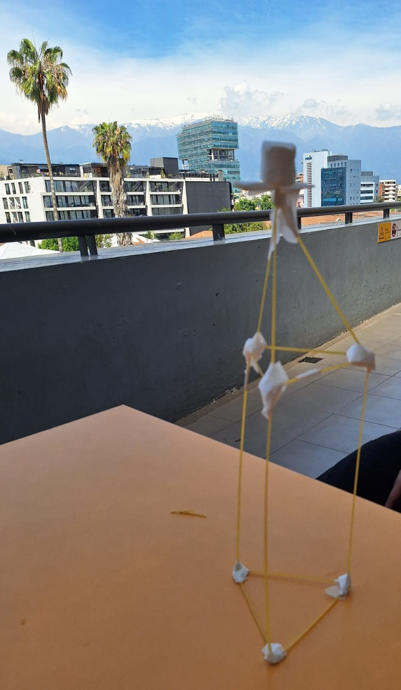

# S13 - Planificación del prototipo, presentación de la solución y desafío del marshmallow

**Fecha:** 05-11-2026
**Participantes:** Bastián Cárcamo, Juan Pérez, Martina Pérez, María Ignacia Pino

**Responsable del registro:** Juan Pérez.

## Objetivo

Preparar el trabajo de la Unidad 3, delimitando las funciones que esperamos demostrar con el prototipo, las pruebas necesarias y la presentación del proyecto. Aplicar el prototipado rápido y la colaboración mediante el desafío del marshmallow, relacionando sus aprendizajes con la construcción y evaluación de la solución para el Lab881.

## Actividades realizadas

1. Respondimos las preguntas de planificación sobre qué funciones estarán listas, cómo demostraremos los resultados y cómo presentaremos la solución en la feria, incluyendo una alternativa de respaldo si el prototipo no funciona como esperamos.
2. Preparamos material de presentación sobre el problema de gestión de residuos de resina en el Lab881 y la propuesta de una caja de registro y curado. Organizamos la explicación del problema, el funcionamiento previsto, el valor de la solución y el cierre.
3. Trabajamos un pitch con participación de los cuatro integrantes: Martina presentó el problema; María Ignacia, la solución y su funcionamiento; Bastián, el valor esperado para el laboratorio; y Juan, el cierre.
4. Participamos en el desafío del marshmallow. Construimos una torre con fideos, uniones de cinta y un marshmallow en la parte superior, buscando que la estructura se mantuviera sola.
5. Relacionamos el ejercicio con la necesidad de probar el prototipo durante su desarrollo y de distinguir entre una función propuesta, una función construida y una función validada.

### Planificación de funciones, pruebas y presentación

**Funciones previstas para la demostración:** La propuesta presentada contempla una balanza dentro de la caja, selección del tipo de residuo, confirmación del ingreso y registro de fecha, hora, tipo y peso. También contempla un ciclo de exposición a una fuente de 405 nm con la tapa cerrada y su interrupción al abrirla. El foco es demostrar un flujo acotado para resina líquida y sólidos con resina, como guantes, toallas y filtros.

**Aspectos que requieren validación o quedan fuera del alcance inicial:** La presentación de la idea no demuestra por sí sola la precisión del pesaje, la integridad de los registros ni la eficacia del curado. Esas funciones necesitan ensayos y evidencia. Tampoco se plantea resolver en esta etapa todos los residuos del laboratorio, incorporar una plataforma externa completa o demostrar que la caja ya está lista para un uso definitivo sin ajustes.

**Pruebas, indicadores y evidencia previstos:**

| Función o aspecto | Prueba prevista | Indicador o criterio a comprobar | Evidencia a conservar |
|---|---|---|---|
| Pesaje y registro del peso | Comparar cargas de referencia con el peso registrado, verificando la tara. | Error y repetibilidad; definir la tolerancia antes del ensayo. | Tabla de referencia, lectura y error, junto con fotografías del montaje. |
| Selección y registro de ingresos | Realizar ingresos de ambos tipos de residuo y comprobar los campos guardados. | Coincidencia del tipo seleccionado y presencia de fecha, hora y peso en cada ingreso de prueba. | Registros exportados y comparación con los casos ejecutados. |
| Bloqueo por apertura de tapa | Abrir la tapa durante el ciclo y comprobar el estado de la salida. | Interrupción de la salida en cada ensayo y comportamiento al volver a cerrar. | Pauta de prueba, número de repeticiones y registro visual. |
| Curado previsto | Ensayar muestras bajo condiciones definidas de exposición. | Resultado según un criterio técnico previamente establecido, registrando tiempo, cantidad y disposición de la muestra. | Condiciones, observaciones, resultados y limitaciones de cada ensayo. |
| Uso y demostración | Recorrer la secuencia completa de depósito, selección, confirmación y revisión de datos. | Finalización del flujo y registro de errores o dificultades de uso. | Pauta de observación, capturas y comentarios de quienes prueben el sistema. |

**Presentación en la feria y plan de respaldo:** La exposición se organizará alrededor del problema del Lab881, la propuesta y una demostración breve con evidencia del funcionamiento. La distribución del pitch trabajada en esta sesión sirve como preparación del equipo completo. El material de clase indica que la competencia de pitch contempla dos integrantes por equipo; la selección de esos representantes se concretará antes del ensayo de feria.

Como respaldo, se prevé preparar un video, capturas o una simulación que permitan explicar el avance si el montaje falla. Ese recurso deberá identificarse como respaldo o simulación y acompañarse de una explicación de las funciones efectivamente probadas y de las que todavía requieren ajustes. Según el calendario presentado en clase, la feria está prevista para el 3 de diciembre y la defensa ante comisión para el 10 de diciembre de 2026.

## Evidencias

- [Preguntas de planificación trabajadas en grupo](../imagenes/S13/preguntas_planificacion.jpeg).
- [Fotografía 1 de la torre construida](../imagenes/S13/marshmallow_1.jpeg).
- [Fotografía 2 de la actividad del marshmallow](../imagenes/S13/marshmallow_2.jpeg).

## Resultados

Se preparó una explicación de la propuesta que conecta la falta de trazabilidad de los residuos con las funciones previstas de la caja: pesaje, clasificación del ingreso, registro y exposición controlada. El trabajo del pitch permitió distribuir la presentación entre los cuatro integrantes y ordenar el mensaje desde el problema hasta el valor esperado para el laboratorio.

La planificación de la Unidad 3 dejó identificados los aspectos que necesitan evidencia: comparar el peso, comprobar los registros, probar el bloqueo de tapa y evaluar el curado bajo condiciones definidas. Estos son ensayos por realizar; no se registran en esta sesión como resultados ya validados del prototipo.

En el desafío del marshmallow construimos una torre con base triangular, apoyos verticales y refuerzos unidos con cinta, con el marshmallow en la parte superior. La estructura se mantuvo sosteniéndose sola hasta el final de la actividad. La altura se estima en aproximadamente **30 cm**, según el recuerdo del equipo y el uso de fideos de alrededor de 25 cm; no corresponde a una medición formal registrada. Las fotografías documentan la estructura construida.

## Decisiones y justificación

| Decisión o criterio de trabajo | Evidencia o criterio utilizado | Consecuencia para el proyecto |
|---|---|---|
| Concentrar la propuesta en el registro y manejo de dos tipos de residuos de resina. | Problema del Lab881 y alcance presentado por el equipo. | Permite preparar una demostración concreta en lugar de abordar todos los residuos del laboratorio. |
| Asociar cada función con una prueba y una evidencia. | Planificación de la Unidad 3 y distinción entre propuesto, desarrollado y validado. | Ayuda a justificar el avance y reconocer lo que todavía necesita comprobarse. |
| Preparar la presentación con aportes de los cuatro integrantes. | Distribución trabajada en el pitch de esta sesión. | Favorece una explicación conjunta del problema, la solución, su valor y sus límites. |
| Prever una demostración de respaldo. | Riesgo de fallos de montaje o funcionamiento durante la feria. | Permite comunicar el avance sin presentar una simulación como si fuera una prueba física. |
| Probar la estructura con su carga y trasladar ese criterio al prototipo. | Desafío del marshmallow y torre que se sostuvo al finalizar. | Refuerza la necesidad de comprobar las funciones durante el desarrollo, antes de la presentación final. |

## Errores, dificultades o riesgos

- **Qué pusimos a prueba:** La estabilidad de una estructura liviana y su capacidad de sostener el marshmallow. La actividad exigió combinar altura, apoyo y uniones, en lugar de considerar únicamente la apariencia de la torre.
- **Riesgo para el proyecto:** Que una presentación convincente se confunda con una demostración de funcionamiento, o que se afirme precisión, eficacia de curado o seguridad total sin contar todavía con pruebas suficientes.
- **Por qué puede ocurrir:** Es posible concentrar el esfuerzo en explicar y construir la solución, dejando para el final la prueba de las funciones y de los supuestos más importantes.
- **Qué haremos para comprobarlo o corregirlo:** Ensayar por funciones, registrar las condiciones y los resultados, identificar fallos y repetir las pruebas después de cada ajuste. En la presentación diferenciaremos los avances construidos de los resultados validados y mantendremos un respaldo de la demostración.

## Aprendizajes

El desafío del marshmallow mostró que el prototipo debe evaluarse con la carga o condición que realmente tendrá que soportar. Para UPCYLAB, esto significa comprobar el pesaje con referencias, revisar el registro con ingresos de prueba y verificar el bloqueo de tapa antes de depender del montaje en una exposición.

También aprendimos que preparar el pitch requiere ponerse de acuerdo sobre qué problema resolvemos, qué podemos demostrar y qué permanece pendiente. La participación de los cuatro integrantes debe reflejarse en decisiones y una explicación compartida de la solución, además de la distribución de los turnos de exposición.

## Tareas y responsables

| Tarea | Responsable(s) | Fecha límite | Estado |
|---|---|---|---|
| Responder las preguntas de planificación de la Unidad 3. | Todo el equipo | Sesión S13, 05-11-2026 | Realizado |
| Preparar la presentación de la solución y trabajar el pitch. | Martina, María Ignacia, Bastián y Juan | Sesión S13, 05-11-2026 | Realizado |
| Construir y probar la torre del desafío del marshmallow. | Todo el equipo | Sesión S13, 05-11-2026 | Realizado; estructura autoportante al finalizar |
| Preparar un primer avance demostrable del prototipo. | Todo el equipo | Hito del curso: 12-11-2026 | Pendiente al cierre de esta sesión |
| Integrar funciones, ejecutar pruebas y reunir evidencias. | Todo el equipo | Hito del curso: 19-11-2026 | Planificado |
| Ensayar la demostración, preparar el respaldo y confirmar los dos representantes de la competencia de pitch. | Todo el equipo | Ensayo previsto: 26-11-2026 | Planificado |

## Próximo paso

Avanzar en un primer montaje demostrable y preparar pruebas por función. Registrar tanto los resultados esperados como los fallos y ajustes, para llegar a la feria con una demostración respaldada por evidencia y una explicación clara de sus limitaciones.

## Fuentes consultadas

- Material docente de la Unidad 3 de Capstone Intermedio, sesión del 5 de noviembre de 2026: planificación, validación, preparación de feria y desafío del marshmallow.
- Trabajo de presentación de la solución y distribución de intervenciones del equipo durante la sesión S13.
- Registro fotográfico de la actividad del marshmallow y confirmación del equipo sobre la estabilidad de la torre al finalizar.
