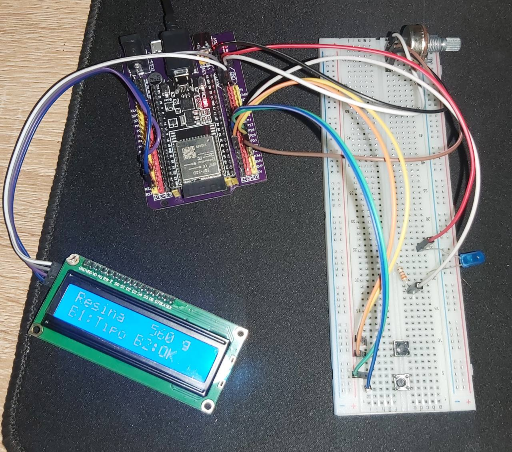

# S15 - Implementación del prototipo ESP32, registro por Wi-Fi y dashboard en Vercel

**Fecha:** 19-11-2026
**Participantes:** Bastián Cárcamo, Juan Pérez, Martina Pérez, María Ignacia Pino

**Responsable del registro:** Juan Pérez.

## Objetivo

Construir y comprobar un primer montaje electrónico demostrable para UPCYLAB, integrando selección de tipo de residuo, ingreso de un peso simulado y registro de datos. Implementar el envío por Wi-Fi y un dashboard web para visualizar los registros, diferenciando las funciones comprobadas de las pruebas de pesaje real, curado y seguridad que permanecen pendientes.

## Actividades realizadas

El trabajo de S15 comenzó el 19 de noviembre y continuó con ajustes técnicos, pruebas y documentación el 20 de noviembre de 2026.

1. Adaptamos la simulación y el programa del ESP32 a los componentes disponibles: pantalla LCD 1602 I2C, dos botones y un potenciómetro. El primer botón permite elegir entre resina líquida y sólidos/EPIs; el segundo confirma el registro. El potenciómetro representa un peso de 0 a 1000 gramos.
2. Armamos el circuito en protoboard, revisamos las conexiones y cargamos el programa en la placa. Instalamos la biblioteca de la LCD y corregimos la selección de placa en Arduino IDE para utilizar el ESP32 clásico. Añadimos un LED indicador como representación del ciclo asociado a la resina líquida.
3. Probamos una primera ruta de registro por Wi-Fi hacia Google Sheets. Posteriormente construimos un servidor local con almacenamiento SQLite y un dashboard conectado por USB, como alternativa para trabajar sin depender de una red compatible durante esa etapa.
4. Verificamos el intercambio entre el ESP32 y el servidor local, incluyendo la confirmación del guardado y la recuperación de un registro pendiente después de detener y reiniciar el servidor.
5. Implementamos la versión en la nube: una API y un dashboard alojados en Vercel, con una base PostgreSQL de Neon. Adaptamos el firmware para enviar directamente por Wi-Fi, sin necesitar el servidor USB del computador.
6. Mejoramos la actualización del dashboard, unificamos la consulta de estado y registros y ubicamos la API en São Paulo, junto a la base de datos. También optimizamos el firmware para enviar pendientes consecutivamente cuando hay conexión y aplicar esperas progresivas solo ante errores.
7. Organizamos y subimos el código a `software/upcylab/` dentro del repositorio de la bitácora, junto con instrucciones, plantillas y pruebas. Excluimos las credenciales, los registros privados y los archivos generados. El despliegue actual quedó operativo mediante publicación manual.

### Montaje y secuencia de uso

| Componente | Función en el prototipo |
|---|---|
| ESP32 | Ejecutar el programa, conservar pendientes y enviar registros a la API por Wi-Fi. |
| Potenciómetro | Seleccionar manualmente un peso simulado entre 0 y 1000 g. |
| Botón B1 | Alternar entre resina líquida y sólidos/EPIs. |
| Botón B2 | Confirmar el tipo y peso seleccionados. |
| LCD 1602 I2C | Mostrar categoría, gramos y mensajes de conexión o guardado. |
| LED indicador | Representar el ciclo de la resina líquida; no emitir luz UV de tratamiento. |

La secuencia comprobada consiste en elegir un peso mayor que cero, seleccionar la categoría y confirmar. El registro se conserva primero en la memoria del ESP32 y se envía a la API. La pantalla muestra **«Guardado nube OK»** cuando el servidor confirma su almacenamiento. Solo la confirmación de un registro de resina líquida activa el LED de prueba; los sólidos/EPIs se registran sin activarlo. El LED se apaga tres segundos después de la última confirmación de resina líquida.

### Registro y visualización

La versión final de esta etapa utiliza el recorrido **ESP32 → Wi-Fi de 2,4 GHz → API en Vercel → PostgreSQL de Neon → dashboard**. El computador deja de actuar como puente de datos; el ESP32 requiere alimentación y acceso a una red compatible con Internet.

Los registros incluyen un identificador único, tipo, gramos y fechas de medición y recepción. Los kilos se obtienen dividiendo los gramos por 1000. Si el reloj del ESP32 estaba sincronizado, se conserva la fecha de medición; si no había una hora fiable, se utiliza la recepción como alternativa, sin presentarla como la hora original del pesaje.

El dashboard presenta kilos acumulados y por categoría, cantidad de registros, gráfico diario, distribución por tipo, filtros y exportación CSV. Las fechas se almacenan en UTC y se muestran y agrupan en hora de Chile. La vista de ejemplo está separada de los registros guardados y no escribe datos en la base.

## Evidencias

- [Montaje completo con ESP32, LCD, botones, potenciómetro y LED](../imagenes/S15/montaje_esp32_lcd_potenciometro.jpg). La pantalla muestra «Resina 500 g», correspondiente al valor simulado seleccionado.
- [Detalle de las conexiones de la placa ESP32](../imagenes/S15/detalle_conexiones_esp32.jpg).
- [Captura del dashboard publicado, tomada el 20 de noviembre](../imagenes/S15/dashboard_vercel_registros_prueba.png). Los valores visibles corresponden a registros de prueba del montaje, no a generación real de residuos del Lab881.
- [Dashboard UPCYLAB en Vercel](https://upcylab-dashboard.vercel.app).
- [Código del dashboard, la API y el firmware](../software/upcylab/README.md), [programa del ESP32](../software/upcylab/firmware/sketch/sketch.ino) y [pruebas automatizadas de la API](../software/upcylab/test/api.test.mjs).
- [Mediciones del ciclo de consulta antes de optimizar](../Documentos/S15/performance-before.json) y [después de optimizar](../Documentos/S15/performance-after.json): cinco muestras por versión, tomadas durante la comprobación técnica.

Las fotografías muestran el montaje electrónico utilizado. No se incluyen las fotografías de la gramera desmontada, cuya integración no se realizó.

## Resultados

Se pasó de la propuesta y las pruebas planificadas en S14 a un montaje que permite demostrar selección, confirmación, envío y visualización de registros. El funcionamiento del circuito, del registro por Wi-Fi y de la versión optimizada fue comprobado durante el trabajo y confirmado por el equipo.

| Aspecto | Comprobación realizada | Resultado y alcance |
|---|---|---|
| Interfaz de la estación | Girar el potenciómetro, alternar categorías y confirmar con los botones. | La LCD muestra el peso simulado y el tipo; la confirmación genera un registro. No mide masa real. |
| LED de demostración | Confirmar registros de resina líquida y de sólidos/EPIs. | Se activa únicamente por confirmaciones de resina líquida. Es una simulación del ciclo, sin validación de curado. |
| Recuperación en modalidad USB | Detener el servidor, confirmar un registro de sólidos de 360 g y volver a conectar. | El registro pendiente se recuperó una sola vez. Una nueva reconexión no lo duplicó. Esta prueba específica se realizó con el servidor USB. |
| Envío a la nube | Enviar desde la placa por Wi-Fi y revisar la fila en el dashboard de Vercel. | Se confirmó el funcionamiento de la ruta directa a la base de datos, sin el puente USB. |
| Reintentos de la API | Repetir un ID con los mismos datos y probar un ID existente con datos diferentes. | Los reintentos no duplican filas; los datos incompatibles con un ID existente se rechazan. |
| Actualización del dashboard | Consultar el panel antes y después de la optimización. | El intervalo bajó de 10 a 2 segundos; estado y registros llegan en una sola petición. |
| Tiempo de consulta web | Comparar cinco muestras del ciclo de consulta de cada versión. | La mediana pasó de 624 ms a 246 ms. Es una comparación de consultas HTTP en esas condiciones, no un tiempo garantizado del sistema completo. |
| Código y navegación | Ejecutar ocho pruebas de API, revisión del proyecto y comprobaciones en navegador. | Pasaron las verificaciones de datos, fechas, filtros, exportación y reintentos, además de las revisiones de la vista móvil. |

El firmware conserva hasta 20 registros en memoria interna, sin microSD. No sobrescribe pendientes y solo los marca como enviados tras recibir y conservar la confirmación del servidor. La recuperación también quedó implementada en la versión Wi-Fi, pero conviene repetir físicamente el ensayo de corte de conexión en esa modalidad antes de la feria.

Los registros utilizados fueron pruebas del funcionamiento. No permiten calcular todavía la generación real de residuos ni demostrar precisión de pesaje, eficacia de curado o seguridad de una fuente UV.

## Decisiones y justificación

| Decisión | Evidencia o criterio utilizado | Consecuencia para el proyecto |
|---|---|---|
| Mantener el potenciómetro como entrada de peso. | Componentes disponibles y posibilidad de demostrar el flujo de registro. | Permite avanzar con una simulación explícita, dejando el pesaje real para una integración posterior. |
| Usar un botón para categoría y otro para confirmar. | Disponibilidad de dos botones y revisión de la secuencia de uso. | Se conserva una interacción sencilla para la demostración. |
| Utilizar un LED pequeño solo para resina líquida. | Comportamiento definido para la demostración del ciclo. | Distingue categorías sin afirmar que existe una fuente UV de tratamiento integrada. |
| Adoptar una API propia y PostgreSQL en Vercel/Neon. | Necesidad de un dashboard accesible desde distintos dispositivos. | Sustituye la dependencia de Sheets y del servidor local para la versión por Wi-Fi. |
| Conservar pendientes e identificar cada registro. | Prueba de recuperación y necesidad de reintentar ante fallos de comunicación. | Reduce el riesgo de perder o duplicar registros durante la demostración. |
| Versionar el software en una carpeta separada de la bitácora. | Necesidad de reunir documentación y código sin mezclar archivos generados o claves. | Facilita revisar y reproducir el prototipo desde `software/upcylab/`. |
| Mantener publicaciones manuales en Vercel. | La automatización requiere autorizar la app de Vercel sobre el repo de otro propietario. | La web sigue operativa; la conexión automática con GitHub queda pendiente de esa autorización. |

## Errores, dificultades o riesgos

- **Configuración de Arduino IDE:** La compilación inicial no encontraba `LiquidCrystal_I2C.h`; se resolvió instalando la biblioteca. La carga también falló al seleccionar ESP32-S2 para una placa ESP32 clásica; se corrigió usando el perfil adecuado.
- **Conectividad:** El ESP32 requiere Wi-Fi de 2,4 GHz. La dificultad para disponer de esa red motivó la etapa USB; posteriormente se configuró una red compatible para comprobar el envío directo a la nube.
- **Interpretación del LED:** Al probar sólidos no se encendía, tal como estaba definido. Se revisó la categoría seleccionada y se confirmó el encendido al registrar resina líquida.
- **Demora en visualizar registros:** El intervalo de consulta del panel y las esperas entre envíos hacían que la respuesta pareciera lenta. Se redujo el intervalo web, se acercó la API a la base y se ajustaron los envíos del firmware.
- **Datos y permisos:** Se verificó que las claves y los registros privados no se incorporaran al repo. La publicación automática desde GitHub no quedó habilitada por falta de autorización de la app sobre el repositorio; no impidió publicar manualmente.
- **Límites del montaje:** No se integraron una balanza real, una lámpara UV ni el bloqueo por apertura de tapa. Estos elementos y su validación continúan pendientes; no deben presentarse como funciones comprobadas.

## Aprendizajes

Aprendimos que la trazabilidad exige comprobar el recorrido completo del dato: ingreso, confirmación, almacenamiento y visualización. Que la placa envíe una solicitud no equivale a que el registro ya esté guardado; por eso incorporamos una respuesta de confirmación y conservamos los pendientes hasta recibirla.

También distinguimos la demora de envío de la demora de actualización del dashboard. Medir ambas etapas permitió realizar ajustes concretos y mantener una interfaz que responde durante la comunicación.

Finalmente, el avance funcional del software no reemplaza la validación física de la solución. El montaje actual permite demostrar registro y clasificación con pesos simulados; el pesaje real, el curado y la seguridad requieren componentes y pruebas adicionales.

## Tareas y responsables

| Tarea | Responsable(s) | Fecha límite | Estado |
|---|---|---|---|
| Armar y comprobar la interfaz con ESP32, LCD, dos botones y potenciómetro. | Equipo UPCYLAB | Trabajo S15 y continuación del 20-11-2026 | Realizado |
| Implementar registro, confirmación y prueba de recuperación en la modalidad USB. | Equipo UPCYLAB | Trabajo S15 y continuación del 20-11-2026 | Realizado |
| Implementar y probar el envío por Wi-Fi y el dashboard en Vercel. | Equipo UPCYLAB | Continuación técnica, 20-11-2026 | Realizado |
| Optimizar consultas web y envío del ESP32. | Equipo UPCYLAB | Continuación técnica, 20-11-2026 | Implementado; mejora de respuesta confirmada durante las pruebas |
| Publicar código y documentar S15 con evidencias del montaje. | Juan Pérez | Cierre del registro S15 | Realizado |
| Repetir la prueba física de pérdida y recuperación de conexión en la versión Wi-Fi. | Equipo UPCYLAB | Antes de la próxima demostración | Pendiente |
| Preparar el montaje y ensayar el recorrido completo para la presentación. | Equipo UPCYLAB | Antes del ensayo de feria | Pendiente |
| Definir la incorporación de pesaje real y las pruebas de curado y seguridad. | Equipo UPCYLAB | Siguiente etapa de desarrollo | Pendiente |

## Próximo paso

Preparar la demostración del montaje con registros de prueba identificados, repetir el ensayo de recuperación por Wi-Fi y comprobar la secuencia completa desde los botones hasta el dashboard. Organizar el montaje para la presentación y explicar sus límites. La incorporación de pesaje real y de una fuente UV con control de tapa deberá tratarse como una etapa posterior, con criterios y resultados de prueba propios.

## Fuentes consultadas

- Montaje, fotografías y confirmaciones de funcionamiento del equipo durante el trabajo del 19 y 20 de noviembre de 2026.
- Código, instrucciones y pruebas del proyecto [UPCYLAB](../software/upcylab/README.md), incluyendo la API, la configuración del despliegue y el firmware optimizado.
- Registros de comprobación del dashboard y mediciones de consulta web reunidos durante esta sesión.
- [Documentación oficial de Wi-Fi para Arduino-ESP32](https://docs.espressif.com/projects/arduino-esp32/en/latest/api/wifi.html).
- [Documentación de regiones de Vercel Functions](https://vercel.com/docs/functions/configuring-functions/region) y [controlador serverless de Neon](https://neon.com/docs/serverless/serverless-driver).
